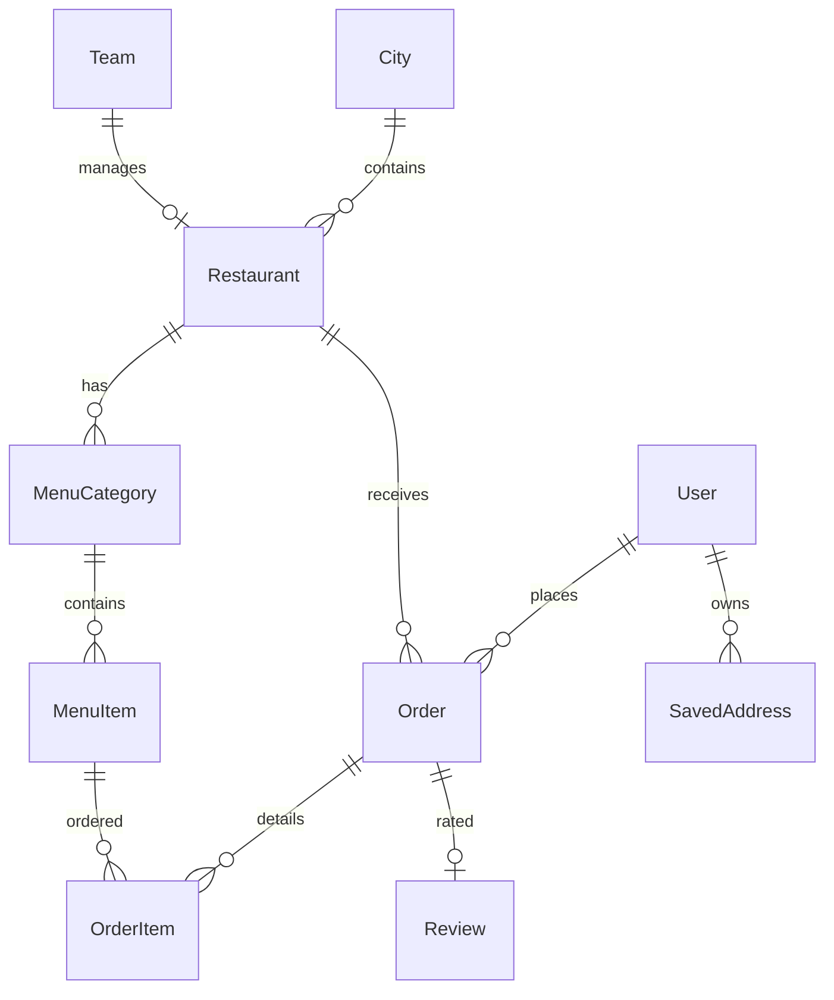

# Implementation Plan - Local Restaurant Ordering Platform

This document outlines the architecture, database schema, and step-by-step implementation details for the web-based Local Restaurant Ordering Platform using Laravel, Vue 3, Inertia.js, and Tailwind CSS.

## User Review Required

> [!IMPORTANT]
> - **Icon Library**: We will use HugeIcons by retrieving clean SVG path definitions via the hugeicons MCP server to render icons inline or in a helper component, satisfying the "Use HugeIcons for icons" constraint.
> - **Visual Style Rules**: We will adhere strictly to:
>   - No emojis.
>   - Prioritizing whitespace over borders or excessive boxes.
>   - Using background colors (e.g., `bg-muted` vs `bg-background`) to differentiate sections rather than borders.
>   - No gradients or shadows.
>   - Minimizing cards, and omitting icons on cards.
> - **Restaurant & Team Association**: We will map `Restaurant` to `Team` (each restaurant has a `team_id`), allowing the pre-built Laravel Teams starter kit to serve as the RBAC mechanism for Restaurant Admins.

## Database Schema Design

We will create a set of migrations to support the platform:

### 1. `cities`
- `id` (primary key)
- `name` (string)
- `state` (string)
- `slug` (string, unique)
- `is_active` (boolean, default: true)
- `timestamps`

### 2. `restaurants`
- `id` (primary key)
- `team_id` (foreign key to `teams`, nullable) - for admin panel access delegation
- `city_id` (foreign key to `cities`)
- `name` (string)
- `slug` (string, unique)
- `cuisine_type` (string)
- `description` (text, nullable)
- `address` (string)
- `phone` (string, nullable)
- `operating_hours` (json, operating schedule per day)
- `delivery_fee` (integer, in cents)
- `estimated_delivery_time` (integer, in minutes)
- `estimated_pickup_time` (integer, in minutes)
- `rating` (decimal, default: 0.00)
- `rating_count` (integer, default: 0)
- `image_path` (string, nullable)
- `offers_delivery` (boolean, default: true)
- `offers_pickup` (boolean, default: true)
- `is_active` (boolean, default: true)
- `timestamps`

### 3. `menu_categories`
- `id` (primary key)
- `restaurant_id` (foreign key to `restaurants`)
- `name` (string)
- `description` (text, nullable)
- `sort_order` (integer, default: 0)
- `timestamps`

### 4. `menu_items`
- `id` (primary key)
- `menu_category_id` (foreign key to `menu_categories`)
- `name` (string)
- `description` (text, nullable)
- `price` (integer, in cents)
- `image_path` (string, nullable)
- `is_available` (boolean, default: true)
- `timestamps`

### 5. `orders`
- `id` (primary key)
- `user_id` (foreign key to `users`, nullable for guests, or required for registered users)
- `restaurant_id` (foreign key to `restaurants`)
- `order_number` (string, unique)
- `status` (string: `received`, `preparing`, `ready_for_pickup`, `out_for_delivery`, `completed`, `cancelled`)
- `type` (string: `delivery`, `pickup`)
- `delivery_address` (text, nullable)
- `subtotal` (integer, in cents)
- `delivery_fee` (integer, in cents)
- `service_fee` (integer, default 200, in cents)
- `tax` (integer, in cents)
- `discount` (integer, default 0, in cents)
- `total` (integer, in cents)
- `special_instructions` (text, nullable)
- `estimated_ready_time` (timestamp, nullable)
- `payment_status` (string: `pending`, `paid`, `failed`)
- `payment_method` (string: `card`, `mock`)
- `promo_code` (string, nullable)
- `timestamps`

### 6. `order_items`
- `id` (primary key)
- `order_id` (foreign key to `orders`)
- `menu_item_id` (foreign key to `menu_items`)
- `quantity` (integer)
- `price` (integer, in cents at time of order)
- `customization` (json, nullable)
- `notes` (string, nullable)
- `timestamps`

### 7. `reviews`
- `id` (primary key)
- `user_id` (foreign key to `users`)
- `restaurant_id` (foreign key to `restaurants`)
- `order_id` (foreign key to `orders`, unique)
- `rating` (integer, 1-5)
- `comment` (text, nullable)
- `timestamps`

### 8. `saved_addresses`
- `id` (primary key)
- `user_id` (foreign key to `users`)
- `label` (string, e.g. "Home", "Work")
- `address_line1` (string)
- `address_line2` (string, nullable)
- `city` (string)
- `state` (string)
- `postal_code` (string)
- `timestamps`

---

## Proposed Changes

We will divide the work into a set of structured backend classes and Inertia components:

### Backend Controllers & Routing

#### [NEW] `CityController.php` (file:///Volumes/STORAGE/PROJECTS/Gigs%202023/swiftserve/app/Http/Controllers/CityController.php)
- Handle retrieval of cities.
- Set selected city in session.

#### [NEW] `RestaurantDirectoryController.php` (file:///Volumes/STORAGE/PROJECTS/Gigs%202023/swiftserve/app/Http/Controllers/RestaurantDirectoryController.php)
- Show list of restaurants for the active city.
- Implement search by name or cuisine.
- Implement filtering (cuisine, rating, price range, offers, status).
- Implement sorting (rating, distance, popularity).

#### [NEW] `RestaurantProfileController.php` (file:///Volumes/STORAGE/PROJECTS/Gigs%202023/swiftserve/app/Http/Controllers/RestaurantProfileController.php)
- Show restaurant detail page with menu categorized and organized.

#### [NEW] `CartController.php` (file:///Volumes/STORAGE/PROJECTS/Gigs%202023/swiftserve/app/Http/Controllers/CartController.php)
- Manage cart items in the session.
- Add, update quantity, remove, customize, and calculate totals (subtotal, delivery fee, service fee, tax, total).

#### [NEW] `CheckoutController.php` (file:///Volumes/STORAGE/PROJECTS/Gigs%202023/swiftserve/app/Http/Controllers/CheckoutController.php)
- Display checkout screen.
- Process checkout form (requires address if delivery, handles mock credit card payment, validates promo codes e.g. `WELCOME10`).
- Create order and order items.

#### [NEW] `OrderTrackingController.php` (file:///Volumes/STORAGE/PROJECTS/Gigs%202023/swiftserve/app/Http/Controllers/OrderTrackingController.php)
- Display tracking interface showing progress from "Order Received" to "Completed".
- Add simulated status progression buttons (visible to users to test states).

#### [NEW] `UserAccountController.php` (file:///Volumes/STORAGE/PROJECTS/Gigs%202023/swiftserve/app/Http/Controllers/UserAccountController.php)
- View past orders, detail receipt, reorder functionality.
- Manage saved addresses.

#### [NEW] `RestaurantAdminController.php` (file:///Volumes/STORAGE/PROJECTS/Gigs%202023/swiftserve/app/Http/Controllers/RestaurantAdminController.php)
- Restrict to users who belong to the team associated with the restaurant.
- Manage operating hours, delivery options.
- Manage menu items (availability toggle, CRUD menu items, categories).
- Manage incoming orders (accept, reject, progress status).

#### [NEW] `ReviewController.php` (file:///Volumes/STORAGE/PROJECTS/Gigs%202023/swiftserve/app/Http/Controllers/ReviewController.php)
- Submit rating and review for a completed order.

---

### Frontend Views & Components

We will build clean, modern Vue 3 pages:

#### [NEW] `Cities/Select.vue` (file:///Volumes/STORAGE/PROJECTS/Gigs%202023/swiftserve/resources/js/pages/Cities/Select.vue)
- Simple, beautiful landing page for selecting/detecting city.

#### [NEW] `Restaurants/Directory.vue` (file:///Volumes/STORAGE/PROJECTS/Gigs%202023/swiftserve/resources/js/pages/Restaurants/Directory.vue)
- Clean listing page with filter sidebar/bar, search input, sorting tabs.

#### [NEW] `Restaurants/Profile.vue` (file:///Volumes/STORAGE/PROJECTS/Gigs%202023/swiftserve/resources/js/pages/Restaurants/Profile.vue)
- Menu view with sticky cart sidebar or drawer.
- Item detail dialog for customization.

#### [NEW] `Checkout/Show.vue` (file:///Volumes/STORAGE/PROJECTS/Gigs%202023/swiftserve/resources/js/pages/Checkout/Show.vue)
- Steps for fulfillment type, delivery address selection/creation, promo codes, and mock card info.

#### [NEW] `Orders/Track.vue` (file:///Volumes/STORAGE/PROJECTS/Gigs%202023/swiftserve/resources/js/pages/Orders/Track.vue)
- Real-time status display and status simulator triggers.

#### [NEW] `Account/History.vue` (file:///Volumes/STORAGE/PROJECTS/Gigs%202023/swiftserve/resources/js/pages/Account/History.vue)
- Personal account area, addresses list, order list with quick re-order.

#### [NEW] `RestaurantAdmin/Dashboard.vue` (file:///Volumes/STORAGE/PROJECTS/Gigs%202023/swiftserve/resources/js/pages/RestaurantAdmin/Dashboard.vue)
- Admin workspace split into two tabs: Menu Management and Order Live-Feed.

#### [NEW] `Shared/HugeIcon.vue` (file:///Volumes/STORAGE/PROJECTS/Gigs%202023/swiftserve/resources/js/components/HugeIcon.vue)
- Lightweight wrapper component containing inline SVG path definitions for the required HugeIcons to keep it simple and load fast.

---

## Verification Plan

### Automated Tests
We will write unit/feature tests for checkout, cart calculations, role authorization, and restaurant filters.
- `php artisan test --filter=CartTest`
- `php artisan test --filter=OrderFlowTest`

Tests will use `DatabaseTransactions` according to rules.

### Manual Verification
- Test selecting a city (e.g. "Seattle" or "New York").
- Filter by cuisine (e.g., Italian, American).
- Add items to the cart, add customizations/instructions, verify price calculations in real-time.
- Checkout using simulated credit card payment, enter promo code `WELCOME10` for discount validation.
- Progress order status in the admin dashboard and verify it updates in real-time on the tracking page.
- Write a review for the completed order and see it aggregate.
